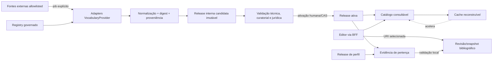
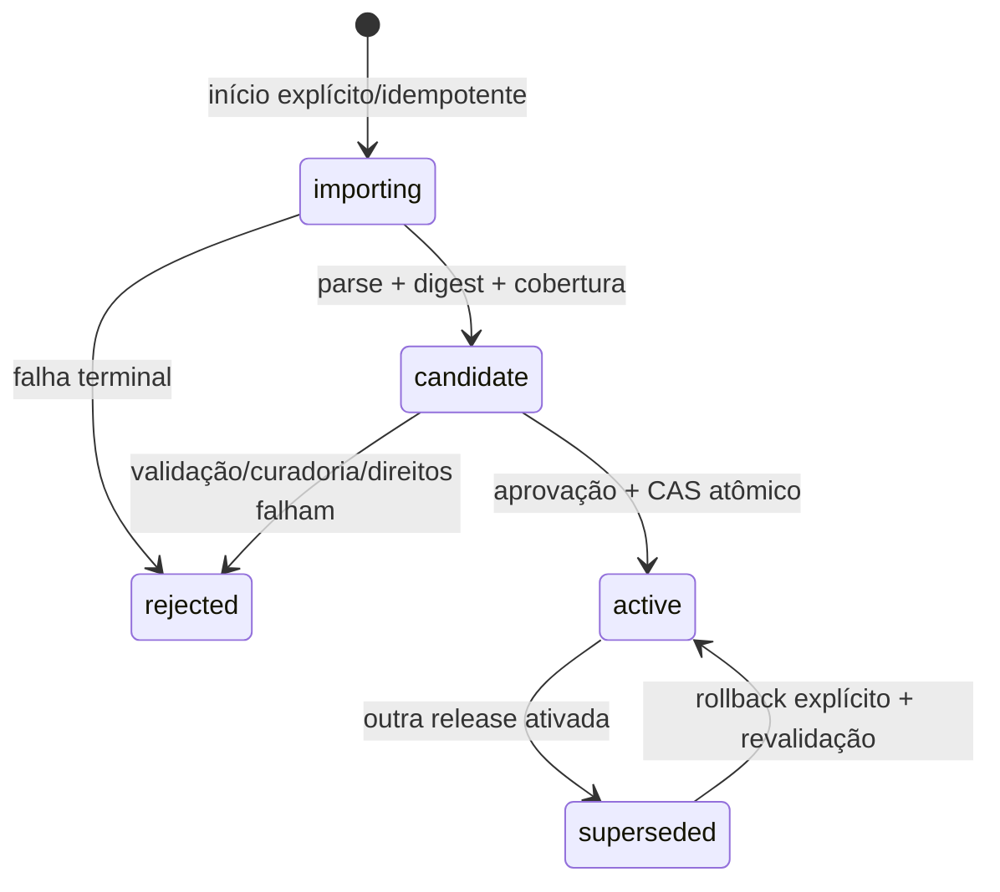

# Especificação operacional de vocabulários — M08.01 / #67

**Status:** proposta técnica revisável, 2026-10-19. Não representa homologação
institucional nem serviço operacional já implantado. A decisão resumida está no
[ADR 0041](../decisions/0041-vocabulary-operations-governance.md).

## 1. Objetivos e limites

Esta especificação transforma os contratos da M03 em um desenho operacional para
fontes confiáveis, releases, catálogo, pertença, cache e integração futura ao editor.
Ela não implementa conectores, sincronização automática, validação remota síncrona,
CRUD administrativo, nova API pública ou migração. Contratos públicos v1, perfis
históricos, BIBFRAME/RDF, UUID/URI, revisões, snapshots e ETags permanecem intactos.

Fontes auditadas: [issue #67](https://github.com/inacioigne/libris/issues/67),
[#24](https://github.com/inacioigne/libris/issues/24),
[#25](https://github.com/inacioigne/libris/issues/25),
[#66](https://github.com/inacioigne/libris/issues/66),
[contrato de vocabulários](controlled-vocabularies.md),
[perfis](catalog-profiles.md), [contrato v1](catalogographic-contract.md),
[editor M07](m07-cataloging-editor.md) e os ADRs 0021, 0024, 0025, 0027, 0031 e 0040.

## 2. Inventário e matriz de integração

Estado: **I** implementado e testado; **P** parcial; **C** contrato existente ainda
não operacionalizado; **D** proposta documentada; **X** inexistente.

| Componente/evidência | Estado | Responsabilidade e dependências atuais | Reuso M08, lacuna e alteração nesta issue |
| --- | --- | --- | --- |
| `application/controlled_values.py` (`ControlledConcept`, `LocalConcept`) | I | Contratos Pydantic 1.0, URI, vocabulary, rótulos, notação, fonte, status e sucessor; depende dos tipos comuns e perfil | Reusar sem substituir. Não é DTO bibliográfico v1 nem store. Sem alteração. |
| `domain/vocabularies.py` (`VocabularyRegistry`) | I/C | Snapshot imutável selecionado pelo chamador; pertença `true/false/unknown`; ausência em conjunto parcial é desconhecida | Núcleo da evidência selecionada. Falta cadastro/governança/persistência. Sem segundo registry. |
| `application/vocabulary_resolution.py` (`VocabularyProvider`) | I/C | Protocol async `resolve(uri)`, resultados tipados, proveniência e cache policy; sem adapter real | Fronteira de consulta. Faltam allowlist, adapters, ingestão e store. Sem alteração. |
| `application/vocabulary_validation.py` | I | Compatibilidade campo/valor, enum, status e pertença; diagnóstico padronizado; não faz I/O | Reusar na validação com registry materializado. Não promover warning de falha a invalidade. |
| `api/schemas/common.py` (`ResourceReference`) | I | Referência pública URI-only nos DTOs Work/Instance/Item/Agent/Subject | Preservar v1. Não comporta snapshot rico; não adicionar campos obrigatórios. |
| `domain/profile_contract.py` / resources `profiles-v2/` | I | Schema 2.0, releases/digests imutáveis; `ReferenceValue(kind="vocabulary", vocabulary=IRI)`; políticas e apresentação | Associação já existe, mas sem release/política operacional. Extensão futura somente em nova release aditiva. |
| `resources/monograph-v1.1.json` | I | Perfil v1 associa language, content, carrier e relator a namespaces LC | Evidência de integração histórica; não reescrever. Media Types ainda não está associado a um campo DTO v1. |
| serialização em `infrastructure/serialization/` | I | Mapeia Read/snapshot para RDF/JSON-LD/Turtle e preserva URI; grafos comparados semanticamente | Manter URI como identidade; metadados de cache não entram silenciosamente no RDF. |
| `infrastructure/persistence.py` e migrações 0001–0004 | I/P | PostgreSQL experimental guarda recursos, revisões JSONB/RDF, perfil, ator, auditoria e ciclo editorial | Snapshots já preservam história. Não criar FK para catálogo nem migration M08.01. |
| M05 API/editorial/listing | I | CRUD, CAS, ETag/If-Match, revisão aprovada/publicada e leitura pública exata | Qualquer escrita futura continua pela mesma transação e revisão; não há endpoint de vocabulário hoje. |
| editores `WorkEditorFields.tsx`/`InstanceEditorFields.tsx` | P | Entrada manual de URI para language, role e carrier; referências de autoridade estruturadas são preservadas | Futuro seletor deve pesquisar catálogo ativo e retornar URI; sem editor universal. Media/content não são cobertos integralmente. |
| `AuthoritySelector.tsx` e BFF `server/catalog/` | I/P | Pesquisa entidades locais via BFF; OIDC, erros e CSRF existentes | Padrão de UX/transporte reutilizável, mas autoridade não é vocabulário e não há busca externa. |
| identidade/autorização M04 | I | OIDC resource server, políticas deny-by-default e contexto técnico restrito | Acrescentar operações específicas em issue futura; não confiar em claims/body para fonte ou ator. |
| catálogo persistente, evidência persistente, releases e jobs | X/D | Não existem | Modelo e ciclo definidos abaixo; implementação reservada. |
| cache real e observabilidade de providers | X/D | Apenas política tipada existe | Implementar depois, reconstruível e separado da evidência. |

Conclusão da auditoria: M03 entregou contrato e validação interna; M05 entregou a
persistência editorial e HTTP; M07 entregou editor/BFF que ainda manipula URIs. Não
existe serviço operacional de vocabulários, importador, cache persistente ou UI de
seleção de conceitos. Uma issue fechada não é evidência do contrário.

## 3. Arquitetura e fronteiras



### 3.1 Registry governado

Um vocabulário tem identificador interno estável, nome oficial, namespace/URI
canônica, mantenedor externo, fonte oficial e técnica, tipos de conceitos, idiomas,
direitos, estados `draft/active/suspended/retired`, política de release/atualização,
estratégia de resolução e autorização para perfis. Configuração usa revisão/CAS.
Suspender impede novas seleções/ingestões, mas não invalida snapshots. A projeção
imutável consumida pela validação continua sendo `VocabularyRegistry` 1.0.

### 3.2 Provider, ingestão e publicação

`VocabularyProvider` consulta uma URI exata e traduz transporte para resultados
tipados. O fluxo em lote, separado, descobre/baixa, limita tamanho, verifica media
type, conserva metadados e digest, parseia sem contextos remotos, normaliza sem
trocar URI, compara com a release anterior e cria candidata. Verificação de identidade
confere URI solicitada/retornada; verificação de pertença produz evidência própria.
Provider atualiza cache apenas após validação e nunca ativa release. Erros e retry
preservam a última evidência, sem converter timeout em `invalid`.

### 3.3 Catálogo de conceitos

Cada conceito conhecido registra URI canônica, vocabulário/release, notação,
rótulos preferidos e alternativos com idioma/origem, estado (`active`, `deprecated`,
`withdrawn`, `unknown`), sucessores/antecessores explícitos e proveniência. “Conhecido”
significa observado em determinada release, não autoridade local sobre a fonte.
Pesquisa pode indexar rótulos, mas seleção sempre retorna URI e release efetiva.

### 3.4 Evidência de pertença

Registro lógico mínimo:

```text
membership_evidence(id, vocabulary_release_id, concept_uri, checked_at,
  evidence_type, result, source_uri, source_identifier, confidence, limitations)
```

`evidence_type` distingue dataset completo assinado/digerido, dataset parcial,
resolução individual e declaração curatorial. `result` distingue `member`,
`not_member`, `unknown`, `no_evidence` e `query_failed`. `not_member` só é válido
com cobertura completa declarada e validada para o escopo; ausência em fonte parcial
é `unknown`. URI não resolvida é `no_evidence` ou `query_failed` conforme resposta.
Conceito retirado/descontinuado é pertença histórica com estado, não ausência.

### 3.5 Cache

Chave: `(provider_id, release_id-or-source-version, canonical_uri, representation,
language-set)`. Sucesso segue inicialmente 24 h; negativo 5 min; retry transitório
60 s; último sucesso pode ser exibido por até 7 dias durante indisponibilidade,
conforme `ResolutionCachePolicy`. Esses defaults exigem ajuste operacional.

Ativação/supersessão invalida alias “active”, não entradas fixadas por release.
Conteúdo com digest divergente é descartado. Cache expirado nunca cria prova negativa;
na falha, a API informa stale/failure. Reconstrução vem de release/evidência, e perda
do cache não afeta registros nem publicação já realizada.

### 3.6 Snapshot bibliográfico

Relação preservada:

- URI canônica: identidade RDF e `ResourceReference` v1;
- rótulo: metadado do `ControlledConcept` ou literal/RDF efetivamente persistido,
  quando o contrato do campo o suporta; nunca substitui a URI;
- release/evidência: usada na validação e registrável em metadado de revisão futuro,
  sem alterar o payload v1;
- perfil: URI exata já persistida na revisão;
- revisão: unidade imutável que impede atualização silenciosa.

Uma mudança de label/cache/release gera, no máximo, sugestão. Aplicá-la exige comando,
autorização, ETag e nova revisão; publicação continua escolhendo revisão aprovada.

## 4. Governança

### 4.1 RACI

| Atividade | Mantenedor externo | Admin Libris | Curador | Catalogador | Operador | Serviço |
| --- | --- | --- | --- | --- | --- | --- |
| Publicar fonte/termos | R/A | I | C | I | I | I |
| Aprovar fonte e direitos | C | A | R | I | C | I |
| Configurar registry/allowlist | I | A | C | I | R | I |
| Iniciar atualização | I | C | C | I | A/R | I |
| Baixar/normalizar/digerir | I | I | C | I | A | R |
| Validar cobertura/rótulos | C | C | A/R | I | C | I |
| Ativar/rollback | I | A | R | I | C | I |
| Selecionar conceito | I | I | C | R | I | I |
| Auditar execução | I | A | C | I | R | I |

R = responsável, A = accountable, C = consultado, I = informado. O serviço nunca
é accountable por aprovação institucional.

### 4.2 Releases e transições



O identificador externo, quando publicado pela fonte, é conservado literalmente.
O identificador interno é UUID e o digest (por exemplo SHA-256) identifica bytes
normalizados. Na ausência de versão externa, `source_release=null`; data de coleta
ou digest não é apresentada como versão do provedor. Importações completas e
parciais declaram cobertura. Releases e eventos são retidos; rollback muda ponteiro,
não apaga nem clona. Toda ativação registra ator, instante, candidata anterior,
justificativa e validações.

### 4.3 Rótulos multilíngues

Cada rótulo registra idioma BCP 47, valor e origem:

- `provider_official`: veio da release oficial;
- `authorized_secondary`: fonte secundária governada e citada;
- `institutional_translation`: tradução local revisada;
- `bibliographic_snapshot`: texto preservado na revisão do registro.

Fallback de exibição: idioma solicitado oficial; tradução institucional no idioma;
idioma padrão oficial; qualquer oficial com idioma explícito; por fim notação/URI.
Nunca remover a tag de idioma nem rotular tradução local como LC. Atualizar catálogo
não atualiza snapshot. Para `pt`, a proveniência tende a ser institucional ou fonte
secundária até comprovação oficial; para `en`, também se registra a release/fonte,
sem presumir oficialidade apenas pelo idioma.

### 4.4 Direitos

O registry exige URI documental, data da verificação, condição de acesso, direito
de cache, transformação e redistribuição, atribuição e limitações. Estados:
`verified`, `restricted`, `pending`. `pending` impede publicação/redistribuição do
dataset derivado e requer revisão jurídica/curatorial; não autoriza inferir licença.
A inexistência de uma licença do próprio Libris reforça que licenças externas não
podem ser escolhidas unilateralmente.

### 4.5 Falhas

| Evento | Estado/efeito |
| --- | --- |
| Timeout, 5xx, fonte inacessível | `query_failed`, retry/backoff; manter último sucesso marcado stale; não invalidar conceito |
| HTTP 429 | respeitar `Retry-After`, pausar provider, circuit breaker; sem autoativação |
| Resposta malformada/content type/tamanho inválido | candidata rejeitada, bytes/digest/diagnóstico auditados; release ativa intacta |
| URI não resolvida/404 | `no_evidence`; só `not_member` se coleção completa comprovar ausência |
| Conceito retirado | preservar pertença/release histórica; impedir nova seleção conforme perfil e sinalizar revisão |
| Conceito substituído | preservar URI antiga e relação explícita; substituição exige escolha/nova revisão |
| Evidência ausente | `unknown/no_evidence`, nunca inferir por prefixo/label |
| Catálogo parcial | ausência é `unknown`; UI identifica cobertura parcial |
| Cache expirado/indisponível | consultar store/release ou informar indisponibilidade; não muda registro |

## 5. Matriz inicial Library of Congress

Verificação em 2026-10-19: as páginas `id.loc.gov` retornaram HTTP 403 neste ambiente.
Namespaces e exemplos são confirmados por documentação oficial `loc.gov` acessível,
pelos contratos já testados do repositório e, para formatos, pela página oficial de
MARC Relators que declara downloads RDF, JSON, MADS e SKOS. A disponibilidade exata
dos mesmos formatos, endpoints de coleção, redirects, headers, ETag/Last-Modified e
release identifiers para as cinco coleções permanece **pendente de ensaio**; não se
inventam endpoints alternativos nem versões. As condições específicas de
redistribuição permanecem `pending` até evidência jurídica por dataset.

| ID sugerido | Nome/mantenedor | Namespace e documentação oficial | Modelo, descoberta, pertença e completude | Release/idiomas/direitos | Integração, atualização/rollback e risco |
| --- | --- | --- | --- | --- | --- |
| `lc-languages` | MARC Code List for Languages; Library of Congress, NDMSO | `http://id.loc.gov/vocabulary/languages/`; [lista oficial](https://www.loc.gov/marc/languages/) | Lista de códigos publicada também como Linked Data; descobrir por distribuição completa a confirmar e URI exata; pertença por item/dataset capturado, nunca prefixo. Exemplo confirmado: `http://id.loc.gov/vocabulary/languages/por` (Portuguese/`por`). | Release formal id.loc: pendente; digest interno obrigatório. Inglês confirmado na lista; pt oficial não verificado. Direitos específicos: pendente. | Work `language`; perfil v1.1 já aponta ao namespace. Atualização explícita; rollback por release interna. Códigos coletivos/descontinuados exigem estado. |
| `lc-content-types` | LC Content Types/RDA Content Types; Library of Congress | `http://id.loc.gov/vocabulary/contentTypes/`; [lista oficial](https://www.loc.gov/standards/valuelist/rdacontent.html) | Vocabulário de termos/códigos; coleção completa e formatos id.loc a confirmar. Exemplo oficial em guia LC: `http://id.loc.gov/vocabulary/contentTypes/txt` (`text`, `txt`). | Release/pt/licença: pendentes; rótulo inglês deve conservar proveniência. | Work `content`; perfil v1.1. Ativação após comparar códigos/URIs; rollback por ponteiro. Risco de confundir código MARC/RDA com versão. |
| `lc-media-types` | LC Media Types/RDA Media Types; Library of Congress | `http://id.loc.gov/vocabulary/mediaTypes/`; [lista oficial](https://www.loc.gov/standards/valuelist/rdamedia.html) | Termos/código de um caractere. Exemplo confirmado: `http://id.loc.gov/vocabulary/mediaTypes/c` (`computer`, `c`). Completude/formato id.loc a ensaiar. | Release/pt/licença: pendentes. | Não há campo correspondente nos DTOs/perfis v1 auditados; integração requer decisão contratual futura, não adaptação silenciosa. Atualização/rollback padrão. |
| `lc-carrier-types` | LC Carrier Types/RDA Carrier Types; Library of Congress | `http://id.loc.gov/vocabulary/carriers/`; [lista oficial](https://www.loc.gov/standards/valuelist/rdacarrier.html) | Termos/códigos de dois caracteres. Exemplos confirmados: `.../carriers/nc` (`volume`) e `.../carriers/cr` (`online resource`). Completude/formato id.loc a ensaiar. | Release/pt/licença: pendentes. | Instance `carrier`; perfil v1.1. Não confundir carrier bibliográfico com item/inventário. Atualização explícita/rollback. |
| `marc-relators` | MARC Code List for Relators; Library of Congress, NDMSO | `http://id.loc.gov/vocabulary/relators/`; [documentação oficial](https://www.loc.gov/marc/relators/) | Termos/códigos; a página confirma download completo em RDF, JSON, MADS e SKOS. Exemplo confirmado: `http://id.loc.gov/vocabulary/relators/aut` (`author`). Pertença pelo dataset/release capturado. | Não foi identificado release formal; avisos técnicos datados existem. Inglês oficial; pt não verificado. Direitos específicos: pendentes. | `Contribution.role`; perfil v1.1. Retém códigos obsoletos/deprecated e avisos; release interna/digest permite rollback. |

Fonte técnica preferida só será escolhida após ensaio reproduzível. Candidatos são
as distribuições completas oferecidas na própria página de cada vocabulário; acesso
por resolução individual serve para consulta, não para provar completude. Não usar
scraping HTML como fonte primária quando houver distribuição oficial verificável.

## 6. Perfis, DTOs e editor

### Contrato existente

```json
{
  "value": {
    "kind": "vocabulary",
    "node_kind": "IRI",
    "vocabulary": "http://id.loc.gov/vocabulary/languages/"
  },
  "presentation": {"input": "select"}
}
```

O schema 2.0 exige uma fonte para `kind=vocabulary`; cardinalidade/obrigatoriedade
ficam em `policy`, e `allowed_values` pode restringir URIs. `validate_catalog_value`
aceita `ControlledConcept`/`LocalConcept` e consulta o `VocabularyRegistry` fornecido.

### Extensão proposta (não implementada)

Em uma nova release compatível do schema de perfil, adicionar configuração opcional,
nunca campos obrigatórios aos perfis atuais:

```json
{
  "value": {
    "kind": "vocabulary",
    "node_kind": "IRI",
    "vocabulary": "http://id.loc.gov/vocabulary/languages/",
    "vocabulary_policy": {
      "allowed_registry_ids": ["lc-languages"],
      "release": {"mode": "pinned", "internal_release_id": "urn:uuid:..."},
      "allow_local_concepts": false,
      "unresolved": "warn_and_block_publication"
    }
  },
  "presentation": {"input": "select", "label_languages": ["pt", "en"]}
}
```

`pinned` fixa release; uma futura política `active_at_validation` só é aceitável se
a release efetiva for registrada com a revisão. Conceitos locais são permitidos
apenas se configurados e continuam `LocalConcept` com UUID/URI institucional.
Obrigatoriedade continua em `policy.min_count/required`, evitando duplicação.

### Exemplo conceitual de seleção (não é DTO v1)

```json
{
  "kind": "controlled_concept",
  "uri": "http://id.loc.gov/vocabulary/languages/por",
  "vocabulary": "http://id.loc.gov/vocabulary/languages/",
  "label": [{"value": "Portuguese", "language": "en"}],
  "notation": "por",
  "source": "https://www.loc.gov/marc/languages/",
  "status": "resolved"
}
```

O editor pesquisa somente releases ativas/autorizadas, informa cobertura e origem,
retorna URI e preserva entrada local em 401/403/409/412/422. Conceito não resolvido
permanece distinguível; perfil decide warning, bloqueio de nova seleção ou bloqueio
de publicação. PATCH mantém omitido/null/[]; seletores não apagam propriedades não
exibidas. A BFF conserva sessão server-side/CSRF; FastAPI continua decisão final.

DTO v1 permanece `{ "uri": "..." }`. Enriquecimento é resposta operacional separada
ou metadado de UI, não alteração implícita do registro. A serialização RDF aponta à
URI canônica, sem embutir labels externos no grafo salvo salvo quando o perfil e uma
nova revisão explicitamente determinarem.

## 7. Persistência e migração

Não há necessidade de tabela nesta fase arquitetural: os contratos não mudam, não há
adapter selecionado nem volume/retention/SLA homologados. Criar schema agora congelaria
decisões abertas. O PostgreSQL de revisões já é suficiente para preservar registros;
o futuro catálogo é auxiliar e separado.

Plano futuro mínimo:

1. pré-condições: direitos/fontes aprovados, adapter testado, quotas e operações RBAC;
2. migration incremental cria registry/release/concept/label/evidence/update-run,
   sem alterar `experimental_semantic_*`;
3. índices por URI, `(vocabulary_id,state)`, `(release_id,notation)`, label normalizado
   conforme necessidade comprovada e cursor de auditoria;
4. constraints de FK/unicidade/check, release ativada imutável e CAS no registry;
5. cadastro inicial inativo, ingestão em banco descartável e validação de contagem;
6. ativação atômica; nenhum backfill de snapshots;
7. rollback funcional reativa release anterior; downgrade de schema recusa apagar
   dados e exige export/backup/ausência de releases; recuperação restaura backup e
   reexecuta job idempotente.

Testes: upgrade/downgrade vazio e populado, unicidade, imutabilidade, publicação
atômica, concorrência de ativação, import parcial/completo, rollback, idempotência,
falha no meio, isolamento transacional e integridade de snapshots existentes.

## 8. Segurança, autorização e resiliência

Matriz proposta; nomes são requisitos futuros, não permissões já implementadas:

| Operação | Acesso |
| --- | --- |
| pesquisar conceitos ativos redistribuíveis | público ou usuário autenticado conforme direitos |
| consultar registry/release/evidência administrativa | curador/operador/auditor autorizado |
| configurar fonte/direitos/allowlist | administrador institucional |
| iniciar/cancelar ingestão | operador; contexto técnico executa somente job autorizado |
| validar candidata | curador e verificações automáticas |
| ativar/rollback | curador + administrador conforme separação de funções |
| alterar permissões | administrador de identidade, fora do módulo bibliográfico |
| ler auditoria | permissão de auditoria específica |

Não reutilizar `system:admin` como wildcard implícito. Operações Next.js passam pelo
BFF com CSRF. Conflito de CAS retorna 412; estado/transição concorrente 409; falta de
permissão 403; credencial inválida 401; entrada estrutural 422; dependência externa
503 com diagnóstico não sensível. Esses códigos são proposta para rotas futuras e
não alteram silenciosamente os endpoints atuais.

SSRF: registry define scheme/host/porta/path, resolve DNS com proteção contra ranges
privados/link-local/loopback, revalida cada redirect, bloqueia credenciais em URL e
contextos remotos. Aplicar timeouts, limites de redirects/bytes/triplas/profundidade,
parsers seguros, content type allowlisted, quotas e rate limit. Logs estruturados
incluem provider/release/run/request ID, contagens, duração e resultado, sem tokens
ou payload integral. Jobs têm idempotency key, lease/heartbeat e retomada segura.

## 9. Cenários de validação

Antes da implementação operacional, exigir:

- URI canônica e RDF isomórfico após round-trip;
- DTOs/OpenAPI v1 inalterados;
- pertença positiva, negativa conclusiva, desconhecida e sem evidência;
- fonte parcial nunca produzindo negativa por ausência;
- deprecated/substituído preservando URI e sucessor explícito;
- timeout/429/5xx/cache perdido sem invalidar registro;
- atualização apenas explícita; releases/digests imutáveis;
- rollback sem apagar release nem revisar snapshots;
- ETag/If-Match e entrada local preservada em conflito;
- RBAC/CSRF/SSRF, limites, idempotência e ativação atômica;
- snapshot/revisão/perfil históricos íntegros e draft não público;
- PostgreSQL descartável para migrations/integração; sem SQLite.

Na M08.01, como só há documentação, a validação aplicável é lint/diff e regressão
geral; nenhum teste deve ser apresentado como integração com LC.

## 10. Riscos e decisões pendentes

- Ensaiar o id.loc.gov fora do ambiente bloqueado e registrar formatos, redirects,
  negociação, headers, limites, completude e identificadores de release.
- Verificar direitos/atribuição/redistribuição por cada um dos cinco datasets.
- Homologar fonte e revisão de rótulos pt; não há evidência de rótulos pt oficiais LC.
- Definir quotas, retenção, RPO/RTO, SLA e volume após amostra real.
- Versionar a extensão aditiva de perfil e decidir como persistir a release efetiva.
- Modelar permissões futuras sem ampliar papéis existentes automaticamente.
- Media Types não possui campo v1 equivalente auditado; requer issue/contrato, não
  adaptação pelo editor.

## 11. Próximas etapas M08

1. Ensaio read-only reproduzível das cinco fontes e parecer de direitos.
2. Contrato versionado do registry/release/evidência e migration incremental.
3. Adapter LC limitado, ingestão explícita e testes com fixtures capturadas legalmente.
4. API de consulta/administrativa com OIDC/RBAC, quotas e auditoria.
5. Seletores incrementais para language/content/carrier/role, preservando DTO v1.
6. Observabilidade, operação de rollback e homologação técnica/institucional separadas.
